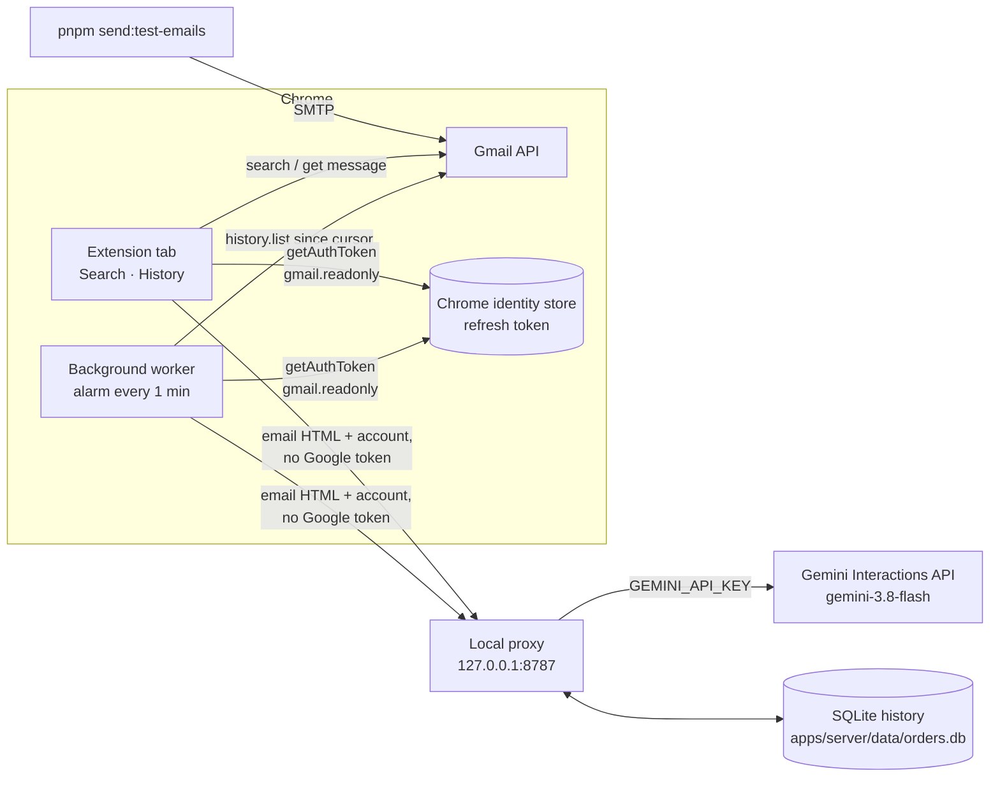

# Order Email Parser

A Chrome extension (Manifest V3) that watches Gmail with **read-only** OAuth access. When an order confirmation from **Mytheresa**, **Selfridges** or **Revolve** arrives, Gemini Flash turns it into JSON: retailer, designer brand, item name, colour, size, price and product image URL. Every parsed email is kept in a per-account history you can browse in the extension.

- **Auto-check.** About once a minute, the extension's background worker asks Gmail what has arrived since the last check. New mail matching the order query is fetched, parsed and saved without you doing anything.
- **Search Gmail.** A button that runs the same query on demand and **parses every matching email straight into History**: no list of raw emails, no click per email. Use it for mail that arrived before auto-check was on.
- **History.** All parsed emails for the signed-in Gmail account, newest first. Each record shows product cards and its stored JSON exactly as saved.
- **Mock emails for testing.** Real orders need a real payment, so `pnpm send:test-emails` delivers realistic order confirmations for all three stores to your inbox.



## The search query

The query is fixed in code and shown read-only in the UI. Both auto-check and **Search Gmail** use it:

```
{from:(mytheresa.com OR selfridges.com OR revolve.com) subject:"[TEST ORDER]"} subject:(order OR confirmation OR confirmed OR "thank you") newer_than:2y
```

`{a b}` is Gmail's OR group, so the query asks Gmail for order-like emails that come **either** from a supported retailer **or** have the `[TEST ORDER]` subject tag. The send script adds that tag, because mock emails come from your own address rather than the store's.

**Gmail's search is only a pre-filter.** It ignores punctuation, so `subject:"[TEST ORDER]"` also matches subjects like "Fix test order" in GitHub notifications. Every result is therefore checked against a **strict rule** (`isAllowedOrderEmail` in `packages/shared/src/retailers.ts`). An email is parsed only if:

- its sender address is on `mytheresa.com`, `selfridges.com` or `revolve.com` (or a subdomain, so look-alikes such as `revolve.com.evil.io` don't count), **or**
- its subject contains the literal, case-sensitive text `[TEST ORDER]`.

The rule runs in three places: **Search Gmail**, auto-check, and the proxy. The proxy refuses anything else with `422 email_not_allowed` before it reaches Gemini or the database. Search reports how many results it ignored. To change the query or the rule, edit `packages/shared/src/retailers.ts`; dropping the test clause there is a one-line change once you no longer need mock emails.

## Output

One history record, as returned by the proxy and shown under **JSON** in the extension:

```json
{
  "account": "you@gmail.com",
  "messageId": "19a3c2f0d1e2b3a4",
  "from": "REVOLVE <you@gmail.com>",
  "subject": "Your REVOLVE order #RV6294758 is confirmed [TEST ORDER]",
  "emailDate": "Wed, 18 Nov 2026 10:02:11 +0000",
  "source": "auto",
  "model": "gemini-3.8-flash",
  "parsedAt": "2026-11-18T10:02:40.512Z",
  "order": {
    "isOrderConfirmation": true,
    "retailer": "Revolve",
    "orderNumber": "RV6294758",
    "orderDate": "2026-11-18",
    "currency": "USD",
    "total": 317.11,
    "items": [
      {
        "name": "Rosalind Mini Dress",
        "brand": "Lovers and Friends",
        "colour": "Black",
        "size": "S",
        "quantity": 1,
        "price": 228,
        "currency": "USD",
        "imageUrl": "https://placehold.co/420x560/111111/ffffff/png?text=Rosalind+Dress"
      }
    ]
  }
}
```

- `retailer` is the store. For real emails it comes from the sender's domain; for mock emails Gemini reads it from the content. `items[].brand` is the designer label.
- `price` is the unit price actually paid, so the sale price when a crossed-out price is shown.
- `imageUrl` is guaranteed to appear in the email. If the model returns a URL that isn't in the email, or one pointing at a logo or tracking pixel, it's replaced with `null`.
- `source` is `auto` for emails parsed by auto-check and `manual` for ones parsed by **Search Gmail** or **Re-parse**.
- The database stores only this record (headers plus parsed JSON), never the email body.
- The full schema is in `packages/shared/src/order-schema.ts` (Zod).

## What I need from you

| #   | Item                                                                                                                        | Used for                                                                                                                      | Goes into                                              | Secret?                     |
| --- | --------------------------------------------------------------------------------------------------------------------------- | ----------------------------------------------------------------------------------------------------------------------------- | ------------------------------------------------------ | --------------------------- |
| 1   | Google Cloud project with the **Gmail API** enabled                                                                         | Reading Gmail                                                                                                                 | —                                                      | no                          |
| 2   | **OAuth consent screen** (External, in Testing mode, with your Gmail address as a test user and the `gmail.readonly` scope) | Sign-in                                                                                                                       | —                                                      | no                          |
| 3   | **OAuth client ID** of type _Chrome Extension_                                                                              | Sign-in                                                                                                                       | `apps/extension/.env` → `OAUTH_CLIENT_ID`              | no (ships in the extension) |
| 4   | Refresh the extension page (Cmd/Ctrl+R)                                                                                     | You stay signed in, with the same history. If the proxy is down, a red error appears **while signed in** (no Sign in button). |
| 5   | **SMTP login.** For Gmail, this is a Google **App Password**                                                                | Sending mock emails                                                                                                           | `packages/test-emails/.env` → `SMTP_USER`, `SMTP_PASS` | **yes**                     |
| 6   | The Gmail address the mock emails go to, which must also be the address you sign in with                                    | Testing                                                                                                                       | `--to` argument of `pnpm send:test-emails`             | no                          |

No database server is needed: SQLite is built into Node 24, and the history file is created on first start.

## Setup from scratch

### 0. Prerequisites

- Node.js **24+** (`node -v`)
- pnpm **11+** (`corepack enable` or `npm i -g pnpm`)
- Google Chrome **116+**. The extension relies on `chrome.identity.getAuthToken`, which only exists in Chrome; Edge, Brave and Arc are not supported.

### 1. Install and create the env files

```bash
pnpm install
cp apps/server/.env.example apps/server/.env
cp apps/extension/.env.example apps/extension/.env
cp packages/test-emails/.env.example packages/test-emails/.env
```

### 2. Pin the extension ID

```bash
pnpm gen:key --write
```

This writes `EXTENSION_PUBLIC_KEY` into `apps/extension/.env`, saves the private key to `extension-key.pem` (gitignored, keep it private), and prints the **Extension ID**. Note it down; steps 3 and 4 use it.

### 3. Google Cloud: Gmail API + OAuth client

1. Open <https://console.cloud.google.com/> and create or select a project.
2. **APIs & Services → Library → Gmail API → Enable.**
3. **Google Auth Platform → Branding** (older consoles call it _OAuth consent screen_):
   - App name: `Order Email Parser`. Add your support email.
   - Audience: **External**. Publishing status: **Testing**.
   - **Audience → Test users → Add users** → add the Gmail address you'll test with.
   - **Data Access → Add or remove scopes** → add `https://www.googleapis.com/auth/gmail.readonly`.
4. **Google Auth Platform → Clients → Create client**:
   - Application type: **Chrome Extension**.
   - Item ID: the **Extension ID** from step 2.
5. Copy the client ID into `apps/extension/.env`:

   ```dotenv
   OAUTH_CLIENT_ID=1234567890-xxxxxxxx.apps.googleusercontent.com
   ```

### 4. Gemini key and proxy config

1. Create a key at <https://aistudio.google.com/apikey>.
2. Edit `apps/server/.env`:

   ```dotenv
   GEMINI_API_KEY=your-key
   ALLOWED_ORIGINS=chrome-extension://<Extension ID from step 2>
   ```

3. Check the key and model with the three built-in mock emails:

   ```bash
   pnpm eval:live     # prints PASS/FAIL per retailer with a field-by-field diff
   ```

### 5. Start the proxy

```bash
pnpm dev:server
# Order parser proxy on http://127.0.0.1:8787 (model gemini-3.8-flash, history ./data/orders.db)
```

Keep it running while you use the extension. Auto-check retries anything that failed while the proxy was down.

### 6. Build and load the extension

```bash
pnpm build          # outputs apps/extension/dist
```

1. Open `chrome://extensions` and turn on **Developer mode**.
2. Click **Load unpacked** and select `apps/extension/dist`.
3. Confirm the ID on the card matches step 2.
4. Pin the extension and click its icon. The app opens in a tab. Click **Sign in with Google**.

After code or `.env` changes, run `pnpm build` again and click the reload icon on the extension card.

## Setting up the test environment

The goal is to get mock order confirmations into your real inbox, so the full flow can be tested without buying anything: Gmail, then auto-check, then Gemini, then history.

### A. Create an SMTP App Password (Gmail)

1. Turn on 2-Step Verification for the Google account that will **send** the emails: <https://myaccount.google.com/signinoptions/twosv>.
2. Create an App Password at <https://myaccount.google.com/apppasswords> (name it "order parser test") and copy the 16 characters.
3. Edit `packages/test-emails/.env`:

   ```dotenv
   SMTP_HOST=smtp.gmail.com
   SMTP_PORT=465
   SMTP_SECURE=true
   SMTP_USER=sender@gmail.com
   SMTP_PASS=abcdabcdabcdabcd
   ```

   The sender can be the same address you test with. Any other SMTP provider works too (Mailtrap, Brevo, Outlook); set host, port and credentials accordingly.

### B. Preview the emails (optional, no SMTP needed)

```bash
pnpm send:test-emails --to you@gmail.com --dry-run --out ./preview
open ./preview/*.html
```

### C. Send them

```bash
pnpm send:test-emails --to you@gmail.com                       # one email per retailer
pnpm send:test-emails --to you@gmail.com --template revolve     # one retailer only
pnpm send:test-emails --to you@gmail.com --count 3              # three of each
```

Each email gets a fresh order number and today's date, so it's always a new message, never a history hit. The subject ends in `[TEST ORDER]`, and the From display name is the retailer ("MYTHERESA", "Selfridges", "REVOLVE").

### D. Change what the mock emails contain

Edit the data in `packages/test-emails/orders/<retailer>.json`: items, brands, colours, sizes, prices, `originalPrice` for sale items, image URLs, shipping and tax. The template in `packages/test-emails/src/templates/<retailer>.ts` controls only presentation, such as uppercase brands, `€ 3,900` versus `£1,250.00`, and date formats.

The expected parser output is computed from the same data (`expectedOrder()`), so the unit tests and `pnpm eval:live` update automatically. Usually a data change is the only edit needed. The parser has no per-store code; Gemini works out which field is which.

### E. Run the end-to-end test

1. Proxy running (`pnpm dev:server`), extension loaded and signed in.
2. In the extension, tick **Auto-check new mail every minute and parse matches**. The status shows "Last checked …". The first check records a starting point and doesn't back-fill existing mail.
3. Run `pnpm send:test-emails --to you@gmail.com`.
4. Within about a minute of the emails arriving, **History** gains three `auto` records with product cards and JSON. If the extension tab is open, the status line says "3 new orders parsed automatically". If it's closed, the toolbar icon shows a badge count until you open it.

## Manual test plan

| #   | Step                                                                                                                                                                                              | Expected                                                                                                                                                                                                                         |
| --- | ------------------------------------------------------------------------------------------------------------------------------------------------------------------------------------------------- | -------------------------------------------------------------------------------------------------------------------------------------------------------------------------------------------------------------------------------- |
| 1   | Click the toolbar icon                                                                                                                                                                            | The app opens in a tab with **Sign in with Google**. Clicking again focuses the same tab.                                                                                                                                        |
| 2   | Sign in                                                                                                                                                                                           | The consent window lists only "Read your email messages and settings". Afterwards the header shows your address, plus the read-only query, the auto-check toggle, **Search Gmail** and **History**.                              |
| 3   | Sign out, sign in, and untick the Gmail permission on the consent screen                                                                                                                          | Red message: "Gmail read access was not granted…".                                                                                                                                                                               |
| 4   | Refresh the extension page (Cmd/Ctrl+R)                                                                                                                                                           | You stay signed in, with the same history. If the proxy is down, a red error appears **while signed in** (no Sign in button).                                                                                                    |
| 5   | Turn **Auto-check** on                                                                                                                                                                            | Status: "Auto-check is on…", then "Last checked <time>".                                                                                                                                                                         |
| 6   | Close the extension tab, then run `pnpm send:test-emails --to you@gmail.com`                                                                                                                      | Within about 1–2 minutes: a badge count on the toolbar icon, and the proxy log shows `parsed … source=auto` three times. Opening the tab clears the badge and shows three new `auto` records in **History**.                     |
| 7   | Check each record against its email in Gmail                                                                                                                                                      | Retailer, order number, date, total, and per item: brand, name, colour, size, quantity, and the price actually paid (Revolve's sandal is **61.60**, not the crossed-out 88.00). Images show the product placeholders, not logos. |
| 8   | Expand **JSON** on a record                                                                                                                                                                       | The full stored record, as in [Output](#output).                                                                                                                                                                                 |
| 9   | Send yourself a normal email whose subject contains `test order` without brackets, plus a test email (`pnpm send:test-emails --to you@gmail.com --template revolve`). Then click **Search Gmail** | The status says `Parsed 1 new email · … ignored (not from an allowed retailer and no [TEST ORDER] tag)`. Only the Revolve mock appears in History. GitHub or other mail that Gmail returns is never parsed.                      |
| 10  | Click **Search Gmail** again                                                                                                                                                                      | `Parsed 0 new emails · N already in history`. Nothing is sent to Gemini twice.                                                                                                                                                   |
| 11  | Click **Re-parse** on any record                                                                                                                                                                  | Gemini runs again (proxy log `parsed …`) and the record's `parsedAt` updates.                                                                                                                                                    |
| 12  | Stop the proxy, send another test email, wait 2 minutes                                                                                                                                           | The auto-check status shows "1 email in the queue, not parsed yet. Next attempt within a minute (each email is tried up to 5 times) · Reason: Cannot reach the parsing proxy…", and the icon shows a red `!`.                    |
| 13  | Start the proxy again and wait up to a minute                                                                                                                                                     | The pending email is parsed, the error clears, and the record appears.                                                                                                                                                           |
| 14  | Restart Chrome                                                                                                                                                                                    | Auto-check continues: the alarm is restored on startup.                                                                                                                                                                          |
| 15  | Sign out                                                                                                                                                                                          | Auto-check turns off, access is revoked (the app disappears from <https://myaccount.google.com/connections>), and the history UI is hidden. Signing back in shows the same history.                                              |
| 16  | Sign in with a different Google account (a test user too)                                                                                                                                         | History is empty for that account. Auto-check starts a fresh cursor for it.                                                                                                                                                      |

Proxy-only checks (no extension needed):

```bash
curl -s http://127.0.0.1:8787/healthz
ORIGIN=chrome-extension://<your extension id>
curl -s -X POST http://127.0.0.1:8787/v1/orders/list -H "Origin: $ORIGIN" -H 'Content-Type: application/json' -d '{"account":"you@gmail.com"}'
curl -s -X POST http://127.0.0.1:8787/v1/orders/list -H 'Content-Type: application/json' -d '{"account":"you@gmail.com"}'   # → 403 forbidden_origin
```

All test methods, including automated tests, mutation testing, live model evaluation and security checks, are described in **[TESTING.md](TESTING.md)**.

## Token storage and refresh

**The short version:** the extension never stores an OAuth token itself. Chrome holds the long-lived credential, access tokens exist only in memory for the length of a request, and the Gemini key stays on the proxy.

- **Who holds the refresh token.** `chrome.identity.getAuthToken` (with the _Chrome Extension_ OAuth client type) lets Chrome do the OAuth exchange and keep the long-lived grant in the browser profile's identity store. The extension's JavaScript never sees a refresh token.
- **Access tokens.** These are short-lived (about 1 hour). The UI and the background worker ask Chrome for one per operation (`interactive: false`) and pass it straight to the Gmail `fetch` call. It is never written to `chrome.storage`, logs or the proxy. `chrome.storage.local` holds only the auto-check switch, the Gmail history cursor, IDs of messages waiting to be retried, the last error and the badge count. A unit test checks that no token is ever written there.
- **Refresh.** Chrome refreshes cached tokens silently. If Gmail still answers **401**, the token is evicted with `chrome.identity.removeCachedAuthToken` and the call is retried **once** with a fresh token. A second 401 means the grant is gone: the UI asks you to sign in, and auto-check pauses with "sign in again to resume" (red `!` badge) rather than looping.
- **Background use.** The background worker only ever requests tokens non-interactively, so it can't pop up a consent window. It works while Chrome has a valid grant and pauses otherwise.
- **Least privilege.** The only OAuth scope is `gmail.readonly`, and only Gmail's read (`GET`) endpoints are called. The extension permissions are `identity`, `storage` and `alarms`, plus host access to `gmail.googleapis.com`, `oauth2.googleapis.com` and the proxy. If you untick the Gmail permission during granular consent, the token is discarded.
- **Sign-out.** This turns auto-check off, evicts the cached token, revokes the grant at `https://oauth2.googleapis.com/revoke`, and clears Chrome's token cache. The cache is cleared even if revocation fails because you're offline.
- **The Gemini key** lives only in `apps/server/.env` (gitignored). It's read by a proxy bound to `127.0.0.1`, sent in the `x-goog-api-key` header, and requests use `store: false`. The proxy answers only requests whose `Origin` is your extension, so web pages can't read your history or spend your quota through `localhost`.
- **The SMTP password** for test emails lives only in `packages/test-emails/.env` (gitignored) and is used only by the send script.
- **Data at rest.** The SQLite history stores, per (account, message): sender, subject, date, model, timestamp and the parsed order JSON. It never stores raw email bodies, and a test checks the table has no body columns. Delete `apps/server/data/orders.db` to wipe it.
- **Why every proxy route is a POST.** Chrome sends the `Origin` header on extension POSTs, but **omits it on GETs** to hosts the extension has host permission for ([Chromium issue 40628751](https://issues.chromium.org/issues/40628751)). A GET from the extension would look like an anonymous local request and be rejected, so the history list is `POST /v1/orders/list`.
- **Untrusted email content.** Hidden elements (where prompt injection usually hides) are stripped before prompting. The model has no tools; output must pass strict Zod validation; image URLs must appear in the email; and the UI renders email-derived strings with `textContent` only, under a CSP that forbids remote scripts.

**If this ships beyond a personal test.** Put the proxy behind HTTPS with real user authentication, so it verifies who the account belongs to instead of trusting the extension's `account` field. Store secrets in a secrets manager. Expect Google's restricted-scope verification for `gmail.readonly` before leaving Testing mode. For instant delivery instead of a 1-minute poll, use Gmail push (`users.watch` → Cloud Pub/Sub → your server).

## Troubleshooting

| Symptom                                                          | Fix                                                                                                                                                                                                                                                                                                                        |
| ---------------------------------------------------------------- | -------------------------------------------------------------------------------------------------------------------------------------------------------------------------------------------------------------------------------------------------------------------------------------------------------------------------- |
| `pnpm build` fails with "Extension build settings are invalid"   | Fill in `OAUTH_CLIENT_ID` and `EXTENSION_PUBLIC_KEY` in `apps/extension/.env`.                                                                                                                                                                                                                                             |
| Sign-in error "bad client id" or "OAuth2 request failed"         | The OAuth client's _Item ID_ must equal the ID on `chrome://extensions`, and its type must be _Chrome Extension_.                                                                                                                                                                                                          |
| "Access blocked: app has not completed verification"             | Add your Gmail address under **Audience → Test users**.                                                                                                                                                                                                                                                                    |
| "Gmail API has not been used in project …"                       | Enable the Gmail API (setup step 3.2) and wait a minute.                                                                                                                                                                                                                                                                   |
| Mock emails never show up in **History**                         | Check that they arrived in the **Inbox** (not Spam or Promotions; if they're in Spam, mark them "Not spam"). Check the subject ends with `[TEST ORDER]` and that auto-check status shows a recent "Last checked". Mail that arrived _before_ auto-check was switched on isn't back-filled; parse it with **Search Gmail**. |
| `send:test-emails`: "could not log in"                           | Gmail needs an App Password, not your normal password. 2-Step Verification must be on.                                                                                                                                                                                                                                     |
| Status says "N emails in the queue, not parsed yet"              | Those emails matched but couldn't be parsed yet; the "Reason" says why (proxy down, Gemini rate limit…). They stay queued and are tried again every minute, up to 5 times each. After that, use **Search Gmail** to parse them.                                                                                            |
| Asked to sign in again after about 7 days                        | This is expected while the consent screen is in **Testing** mode.                                                                                                                                                                                                                                                          |
| Refreshing the page shows a red error but you're still signed in | The proxy is down or misconfigured; the message says which. Sign-in is checked separately and isn't affected.                                                                                                                                                                                                              |
| A non-order email (e.g. GitHub) in History                       | Records saved before the strict rule existed are hidden from History automatically. New ones can't be created, because the proxy refuses them.                                                                                                                                                                             |
| "The proxy rejected this extension"                              | `ALLOWED_ORIGINS` must be exactly `chrome-extension://<id>`. Restart the proxy after editing.                                                                                                                                                                                                                              |
| `upstream_error … API key not valid` / `model not found`         | Fix `GEMINI_API_KEY` or `GEMINI_MODEL` in `apps/server/.env` and restart.                                                                                                                                                                                                                                                  |

## Project layout

```
apps/extension/        MV3 extension: auth, Gmail client, background watcher, history UI
apps/server/           Hono proxy (Node 24): HTML preprocessing, Gemini client, SQLite history
packages/shared/       Zod schemas (order, record, requests) + retailer detection + the fixed query
packages/test-emails/  Mock email templates, order data, send script (SMTP)
scripts/               gen-extension-key.mjs, mutation-check.mjs
```

## Limitations

- **Chrome only.** `chrome.identity.getAuthToken` isn't available in other Chromium browsers.
- **Up to about a minute of delay.** Auto-check polls every minute (Chrome's minimum alarm period) and runs only while Chrome is open. There's no Pub/Sub push.
- **No back-fill.** Turning auto-check on starts from "now"; existing mail is parsed with **Search Gmail**.
- **The account field is trusted.** The proxy assumes the `account` it receives is correct. That's fine for a local, origin-locked proxy, but not for a shared server (see above).
- **Mock emails aren't real.** They mirror each store's layout but aren't real emails, so test with a real order when you can.
- **Model output can be wrong.** Wrong values are possible even when they pass the schema. The image-URL grounding and the domain-based retailer are the only fields enforced in code.
- **Dev-dependency advisory.** `pnpm audit` reports one high-severity advisory, picomatch ReDoS (GHSA-fc5q-39xc-vjpf), pulled in via vitest/vite. It affects tooling only, and no patched release exists yet.
